<!-- SPDX-License-Identifier: MIT — Copyright (c) 2026 Paul Richeson -->

# Static Stream — feature guide

A tour in pictures: what each part of staticstream is, why it exists, and how it fits the whole. Performed by `tools/feature-guide.py` on 2026-10-20 against the release build of 0.2.0, in a throwaway HOME, and written with the numbers that were on the screen. Run `python3 tools/feature-guide.py` to perform it again; it rewrites `docs/features/`.

> **What was real and what was not.** Every terminal picture is a real session: the commands are the commands that ran, and the output is what `sstr`, `ytq` and `sstr-workspace` printed. The one edit is the one a shell makes: the throwaway HOME is written `~`. Around that:
> - the **signing key** was made for the demo with `ssh-keygen` and thrown away afterwards; no real key was used;
> - the **video** is ffmpeg's `testsrc2` test pattern, recorded live as MPEG-TS, not a download;
> - **`damage`** and **`noise`** are this repository's own `tests/damage.py` and `tests/noise.py`, the tools the crosscheck breaks captures with, under short names;
> - **ytq** drove the stand-in `tests/standin/yt-dlp`, which answers as yt-dlp does and never reaches the network. The "Fake Title — café" is the stand-in's;
> - the **player** at the far end of `--serve` was `ffprobe` and `ffmpeg`, not VLC or mpv.
>
> Pictures 1 and 3 are drawn, not captured, from the layout in `src/format/mod.rs`, `record.rs` and `writer.rs`.

For installing and building, see the [README](../README.md); for the design underneath, [architecture.md](architecture.md).

## Contents

1. [The journey: record, keep, damage, verify, let go](#part-1)
2. [Recording a stream](#part-2)
3. [The file, record by record](#part-3)
4. [Verify: every check, in one report](#part-4)
5. [The inner code: bit errors and bursts](#part-5)
6. [The outer code: whole records lost](#part-6)
7. [The chain and the signature: tampering and truncation](#part-7)
8. [Pace: played back as it arrived](#part-8)
9. [Serve: to a player, while still recording](#part-9)
10. [Armor: a capture over a serial line](#part-10)
11. [Export: a folder back out as files](#part-11)
12. [ytq: downloads kept as signed captures](#part-12)
13. [The Workspace: looking, and sending verbs](#part-13)
14. [How it fits together](#part-14)

## 1. The journey: record, keep, damage, verify, let go

**Why it exists.** A file keeps bytes, but a stream also has an order, a pace and a way of failing: a byte stream recorded into an ordinary file loses the pace, and a damaged ordinary file says nothing about what was lost. A static stream keeps all three, and lets the stream go again later.

**How it fits.** Everything in this guide is one of these five steps, or a program that calls them. `sstr` is the command; ytq and the Workspace reach the same format through the same library.

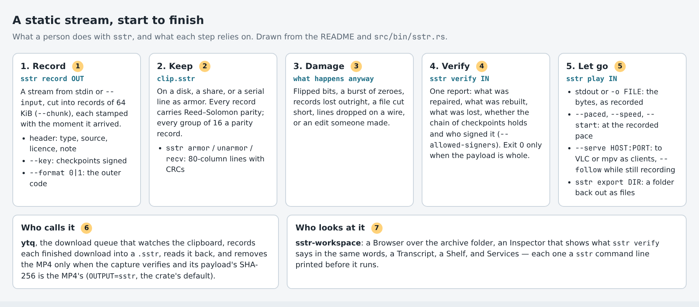

*Figure 1. The journey of a static stream, start to finish.*

1. **Record**: `sstr record` cuts the stream into records of 64 KiB (`--chunk`), each stamped with the time it arrived.
2. **Keep**: on a disk, or on a serial line as armor.
3. **Damage**: what happens to files and wires anyway.
4. **Verify**: one report of what was repaired, rebuilt, lost and signed.
5. **Let go**: to a file, at its pace, to players over HTTP, or a whole folder at once.
6. **ytq** records what it downloads.
7. **sstr-workspace** looks at what is kept.

Nothing is encrypted and nothing is decoded, so no codec is involved: what comes out is the bytes that went in.

## 2. Recording a stream

**Why it exists.** A capture has to say what it is long after it is separated from the program and the machine that made it. So the source, the licence and a note go into the capture's own header, and the key that signs it is named there too.

**How it fits.** Everything later reads this header: `verify` prints it, the Workspace's Inspector shows it, and `export` picks the file's extension from its `content_type`.

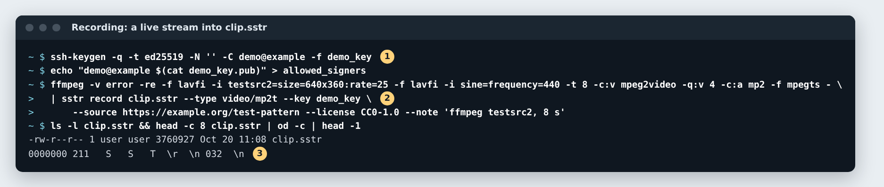

*Figure 2. Recording ffmpeg's test pattern, live, into clip.sstr.*

1. A throwaway Ed25519 key for the demo, and an `allowed_signers` file that trusts it. Signing uses `ssh-keygen -Y sign`, so the key is any SSH key; ytq's default is `~/.ssh/id_ed25519` when there is one.
2. The stream arrives on stdin, at ffmpeg's real-time pace (`-re`). `--type`, `--source`, `--license` and `--note` go into the header; `--key` signs the checkpoints.
3. The file begins with the signature `\x89SST\r\n\x1a\n`, after PNG's: a high-bit byte, CR LF, ^Z, LF.

The 2,877,528-byte stream became a 3,760,927-byte capture: 31 % more, for a short capture. For 20 MB of random bytes the same build measured 30 % at version 1 and 22 % at version 0; the README's "about 21 %" is version 0's design figure, (1 + 32/223) × (1 + 1/16), and version 1's second parity row adds about 6 % to it.

**Check yourself**
- `sstr record OUT` with no input bytes at all exits 1 and leaves no file — a deliberate difference from the prototype, because a failed download looks exactly like that.
- `--deflate` compresses a record only when that saves 5 %; `--format 0` writes the older outer code.

## 3. The file, record by record

**Why it exists.** Each layer of protection catches a thing the others cannot, and each can be absent without disabling the rest: a CRC on every header, Reed–Solomon on every byte, parity across records, a hash chain across the stream, and a signature on the chain.

**How it fits.** Parts 5 to 7 break this layout on purpose, one layer at a time.

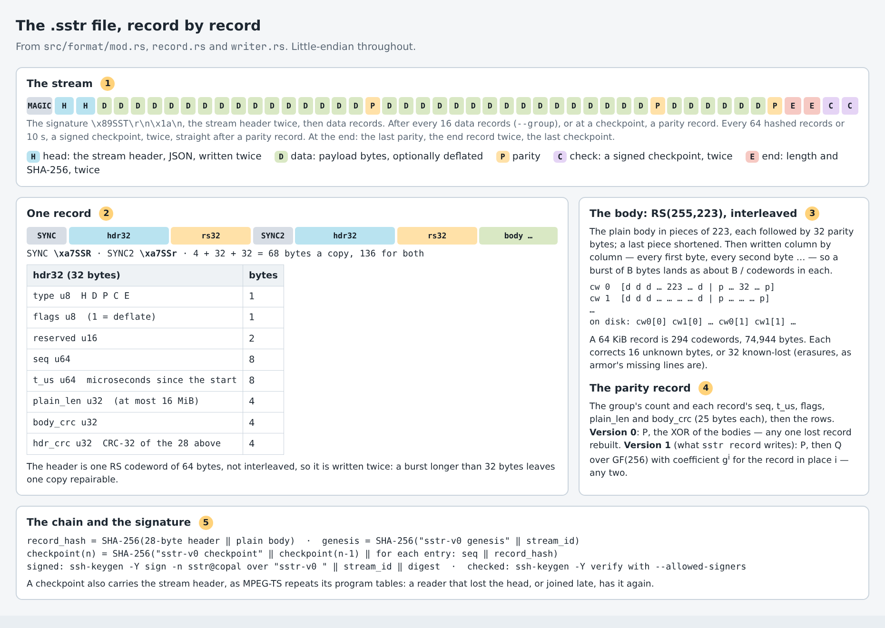

*Figure 3. The .sstr layout, drawn from `src/format/`.*

1. **The stream.** The signature, the stream header twice, then data records. A parity record after every 16 data records (`--group`) or at a checkpoint; a signed checkpoint every 64 hashed records or 10 s, twice, straight after a parity record, so a reader has rebuilt what it can before it checks. At the end: the last parity, the end record twice, the last checkpoint.
2. **One record.** Two sync markers (`\xa7SSR`, `\xa7SSr`) let a reader find the next record after any wreck — the reports' "bytes skipped in resyncs". The 32-byte header is one RS codeword, not interleaved, so it is written twice.
3. **The body.** RS(255,223) codewords, interleaved byte by byte, so a burst is spread thinly over every codeword of the record.
4. **The parity record.** Version 0 carries P, the XOR of the group, and rebuilds any one lost record. Version 1, what `sstr record` writes, adds Q over GF(256) and rebuilds any two. P is version 0's own row, which is why a version 0 reader can still rebuild a single lost record from a version 1 capture.
5. **The chain.** Each checkpoint hashes the one before and every record since, so changing any record changes every checkpoint after it: the chain fixes the order and the set, not only the contents. A checkpoint also repeats the stream header, as MPEG-TS repeats its program tables.

## 4. Verify: every check, in one report

**Why it exists.** A reader that repairs quietly would hide how close a capture came to being lost. `sstr verify` reads the whole capture as `play` would and reports every layer, in the prototype's words, and exits 0 only when the payload is the one the end record describes.

**How it fits.** The same report appears everywhere: in the Workspace's Inspector, under a damaged capture in `export`, and in ytq's check before it deletes anything.

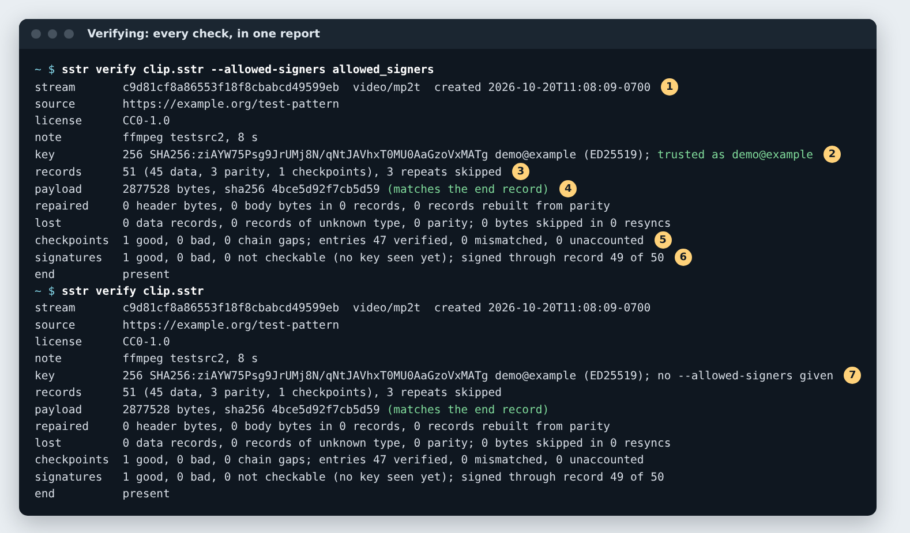

*Figure 4. `sstr verify` on the fresh capture, with and without a trust file.*

1. The stream's id, content type and creation time, then the header's source, licence and note.
2. The signing key's fingerprint, **trusted as demo@example** because `--allowed-signers` named it.
3. 51 records: 45 data, 3 parity, 1 checkpoint, and the repeated copies the reader skips.
4. The payload's length and SHA-256, matched against the end record.
5. The checkpoint chain: 47 entries verified, none mismatched or unaccounted.
6. The signature on the chain, good, through record 49 of 50.
7. Without a trust file every hash is still checked, but the report says the signature was not judged — it does not quietly call an unverified capture good.

## 5. The inner code: bit errors and bursts

**Why it exists.** Disks, shares and wires flip bits and drop short runs of bytes. Reed–Solomon with 32 parity bytes per 255 corrects up to 16 wrong bytes in each codeword, and the interleave turns a burst into a few bytes per codeword.

**How it fits.** This is the first line: what it corrects never reaches the parity records, and nobody has to be told — except by the report.

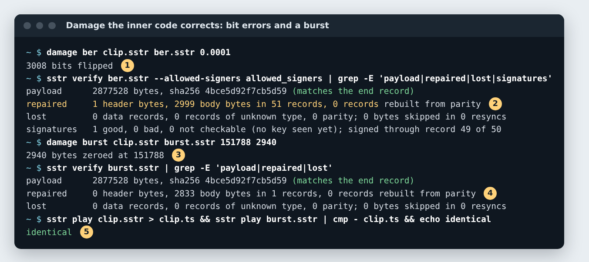

*Figure 5. Bit errors and a burst, corrected.*

1. One bit in 10,000 flipped at random across the whole file: 3,008 bits.
2. 1 header byte and 2,999 body bytes repaired, in all 51 records; the payload's SHA-256 matches and the signature is good.
3. 2,940 zeroed bytes in a row, inside the body of the third data record — about ten bytes in each of its codewords.
4. 2,833 bytes repaired in that one record (the rest were already zero).
5. Played back, the burst capture is byte for byte the clean one.

## 6. The outer code: whole records lost

**Why it exists.** Some damage is too big for any codeword: a lost sector, a dropped run of a transfer. Parity across a group of records rebuilds a record that is gone outright. Version 1 exists because two lost records of one group come back instead of one, for about 6 % more file.

**How it fits.** The reader resyncs past the wreck on the sync markers, then rebuilds from the group's parity record before it checks the checkpoint.

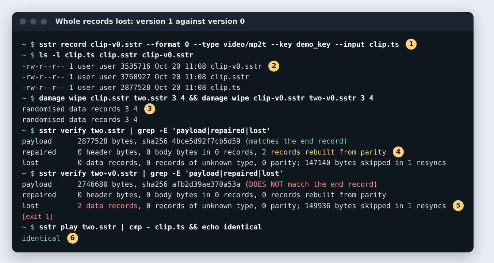

*Figure 6. The same two records wiped at version 1 and at version 0.*

1. The same stream recorded again at version 0, from the bytes `sstr play` gave back.
2. Version 0 is 3,535,716 bytes, version 1 is 3,760,927: the price of the second row.
3. Data records 3 and 4 — both in the first group — overwritten with noise, headers and all, in each.
4. Version 1: **2 records rebuilt from parity**, the payload matches, exit 0.
5. Version 0: 2 data records lost, 2,746,680 bytes of 2,877,528, the hash does not match, exit 1.
6. Version 1 plays back identical to the original stream.

**Check yourself**
- Three lost records of one group are beyond two rows: `make outer-check` shows it, and so does the broken capture in part 11.
- Version 1 is the default; `--format 0` exists for readers that only know version 0, such as the frozen prototype.

## 7. The chain and the signature: tampering and truncation

**Why it exists.** Codes repair accidents; they cannot tell an accident from an edit, because an edit can recompute its own CRCs and parity. The hash chain and its signature can, and the end record tells a finished capture from one that was cut short.

**How it fits.** This is the last line: what the codes could not explain, the chain names.

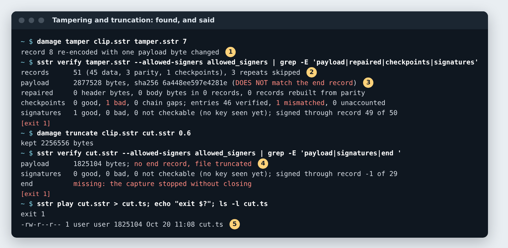

*Figure 7. An edited record, and a capture cut at 60 %.*

1. One payload byte of a data record changed, with its CRCs and Reed–Solomon parity recomputed, so no code sees damage.
2. The checkpoint goes **bad**: 1 entry mismatched. The signature itself is still good — it signed the true chain, and that is how the edit is found.
3. The payload's SHA-256 does not match the end record; exit 1.
4. Cut at 60 %: no end record, no checkpoint reached, so nothing is signed through; the report says the capture stopped without closing.
5. What was there still plays — 1,825,104 bytes — but `play` exits 1, so a script can tell.

## 8. Pace: played back as it arrived

**Why it exists.** A stream is not only its bytes but when they came: a console session, a sensor, a broadcast. Every record carries `t_us`, the microseconds from the start to its first byte, so playback can keep the recorded rhythm, faster or from a point in the middle.

**How it fits.** `--paced` is the same reader with a clock; it also drives `--serve` and the Workspace's **P** (Paced) Service.

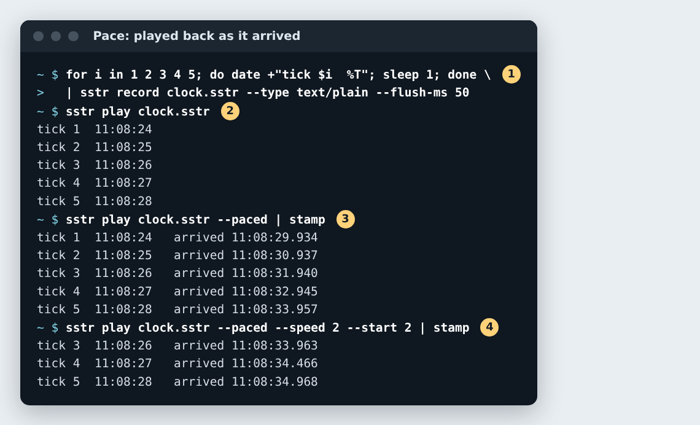

*Figure 8. A five-second clock, recorded and played back at its pace.*

1. One line a second for five seconds, recorded with `--flush-ms 50` so each line becomes its own record promptly.
2. Plain `play` gives the bytes at once.
3. `--paced`: one line a second again, as recorded. `stamp` is a shell loop that appends the time each line arrived.
4. `--speed 2 --start 2`: from two seconds in, at twice the pace — half a second apart.

## 9. Serve: to a player, while still recording

**Why it exists.** The README's third way out: a capture let go to VLC or mpv as clients, even while it is still being recorded. `--serve` is plain HTTP; each client gets its own reader from the start of the capture, so with `--follow` a capture still being written is a timeshift buffer: join late and watch from the beginning.

**How it fits.** The content type comes from the capture's header, and the bytes are the recorded ones: no codec, no transcoding.

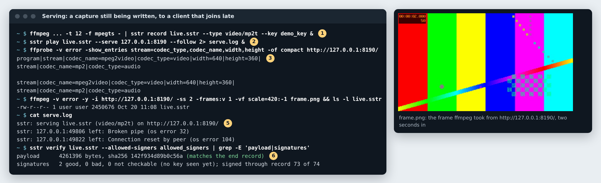

*Figure 9. A live capture served to ffprobe and ffmpeg, while it was still being recorded.*

1. A 12-second test pattern being recorded in the background.
2. Served on 127.0.0.1:8190 three seconds in, following the file as it grows.
3. `ffprobe`, as the client, sees an MPEG-2 video stream at 640×360 and an MP2 audio stream.
4. `ffmpeg` takes the frame two seconds in (on the right, its clock reading 00:00:02.000) while `live.sstr` is still growing.
5. The server's log: one line for each client that left.
6. Once finished, the capture verifies and both its checkpoints are signed.

*Honest note:* the clients here are ffprobe and ffmpeg, because the session had no display; any player that opens an `http://` URL is the same kind of client.

## 10. Armor: a capture over a serial line

**Why it exists.** Some machines are reached only through a serial console. The armor turns a byte stream into 80-column printable lines — no XON or XOFF — each naming its own offset and carrying a CRC-32, so a lost line is a known gap rather than a shift.

**How it fits.** A known gap is an **erasure**, and Reed–Solomon corrects erasures at twice the rate of unknown errors. The armor wraps a capture; it does not replace the capture's own codes.

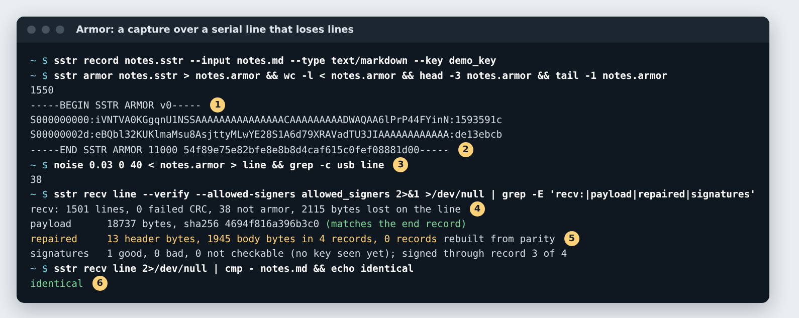

*Figure 10. The README, recorded, armored, sent over a line that drops lines, and received.*

1. 1,550 lines: `S`, a 9-digit hex offset, 45 bytes as 60 base64url characters, a CRC-32.
2. The end line carries the length and the first 40 hex digits of the SHA-256.
3. `noise`: 3 % of the lines dropped, and a kernel message every 40 lines, as on a shared console — 38 of them.
4. `recv`: 38 lines that were not armor dropped, 2,115 bytes lost on the line.
5. 13 header bytes and 1,945 body bytes repaired from the erasures; the signature is good.
6. The received file is byte for byte the README.

`sstr unarmor` is the same without the reading, for a capture to keep; `--erasures FILE` hands the known gaps to a later `play` or `verify`.

## 11. Export: a folder back out as files

**Why it exists.** A `.sstr` is not a file a player opens, and a share full of them looks empty to everything but `sstr`. `sstr export` writes a folder of captures back out as the files they hold, so keeping captures is a choice rather than a commitment.

**How it fits.** Nothing is named as the real file until its capture has verified. It is the Workspace's **x** Service on a capture, and **X** on a folder.

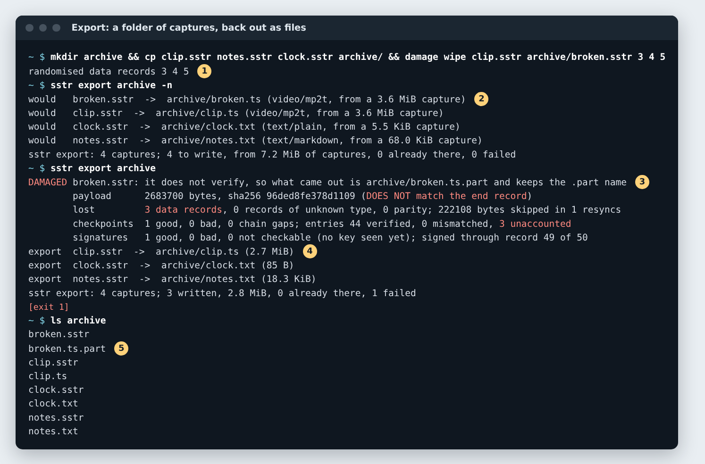

*Figure 11. Export of a folder holding three good captures and one broken one.*

1. A broken copy: three records of one group wiped, beyond what two parity rows rebuild.
2. `-n` says what it would do: the extension comes from each header's `content_type` (`.ts`, `.txt`).
3. The broken capture is reported **DAMAGED**, with its report lines, and its bytes kept as `broken.ts.part`; exit 1.
4. The good ones are written and verified.
5. Afterwards the `.part` sits beside its capture, and each good capture beside its file. Run again, a file already there is skipped and counted, never overwritten or renamed to a `-1` name.

## 12. ytq: downloads kept as signed captures

**Why it exists.** ytq is Copal's download queue that watches the clipboard (Super+Shift+Y queues whatever video links are on it). It archives what it downloads as Static Stream by default, so a download becomes a self-describing, signed capture — and the original is deleted only after the copy has been proved.

**How it fits.** ytq drives yt-dlp as a subprocess, then calls the format's writer and reader. The rule that makes `OUTPUT=sstr` safe as a default: the MP4 goes only when the capture has been written, read back, verified, and its played-back payload's SHA-256 equals the MP4's.

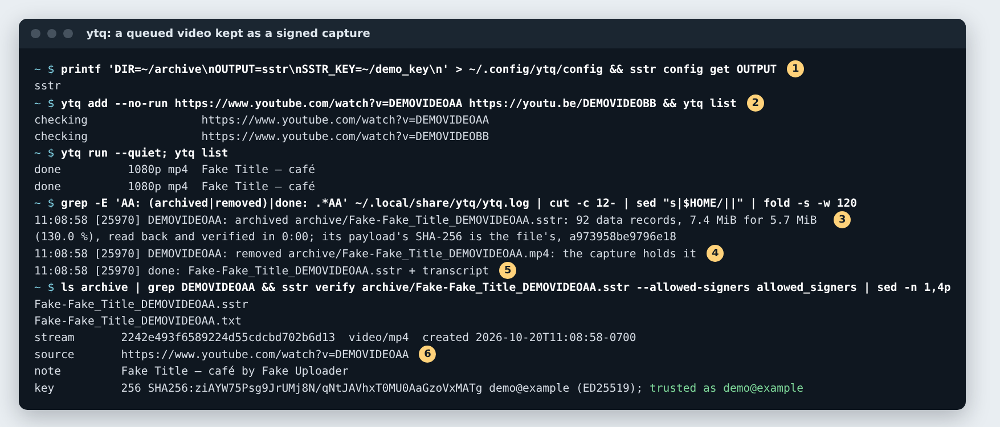

*Figure 12. ytq with the stand-in yt-dlp: two videos queued, downloaded and kept as signed captures.*

1. Three settings: where files go, what is kept (`sstr`, `both` or `mp4`), and the key to sign with. `sstr config` reads the same files ytq does.
2. Two links queued without starting a runner; each is checked before it is downloaded.
3. The log: archived, read back and verified, and the payload's SHA-256 is the file's.
4. Only then: the MP4 removed, "the capture holds it".
5. Done, with a transcript `.txt` beside it — the reference card, the description and the captions.
6. The capture's header names its source page, and the signature is trusted.

*Honest note:* the yt-dlp here is `tests/standin/yt-dlp`; no network was used. With the real one, `ytq` also tags the MP4, fetches captions and comments in runs of their own (so a failure there cannot undo a finished download), and goes through Brave's cookies when a site asks for a sign-in. Copal itself installs `OUTPUT=mp4` for its shared folder; the crate's own default is `sstr`.

## 13. The Workspace: looking, and sending verbs

**Why it exists.** A folder of captures needs a way of looking that is not a media library: no database, nothing to keep in step. The Workspace is a terminal window in NeXTSTEP's and Smalltalk's words — a Browser of columns over the disk, a Shelf, an Inspector, a Transcript, and Services sent to the selection.

**How it fits.** The Inspector shows what `sstr verify` says, in the same words, because it calls the same function. Every Service is a command line, printed into the Transcript before it runs and then run exactly as printed, so it can be read, copied and typed again.

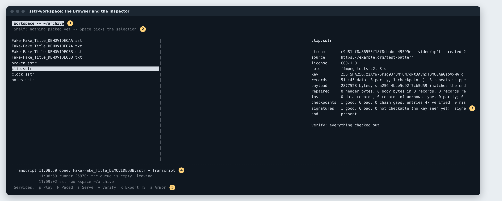

*Figure 13. The Browser over the archive folder, with the Inspector on clip.sstr.*

1. The folder: `ARCHIVE_DIR`, resolved as ytq resolves it. Shift-Q brings ytq's queue in as one more column.
2. The Shelf: Space picks a selection up, and a Service is then sent to everything on it.
3. The Inspector: the `verify` report for the selection, and its verdict (the pane cuts long lines at its width).
4. The Transcript: ytq's log as it is written, and the Workspace's own lines.
5. The Services the selection takes: Play, Paced, Serve, Verify, Export (named for the content type), Armor.

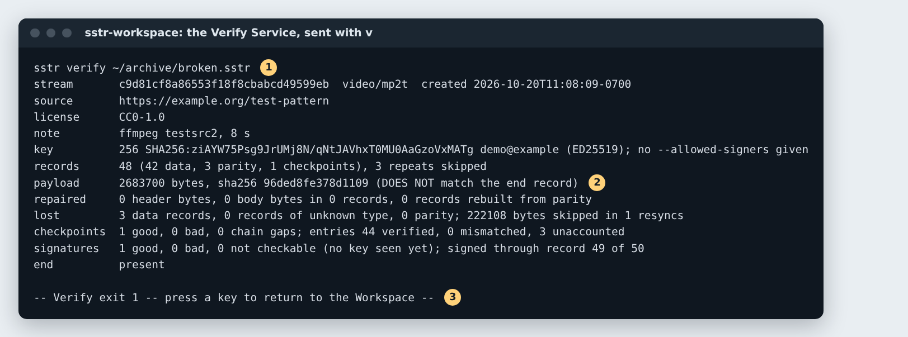

*Figure 14. **v** on the broken capture: the command line, then what it printed.*

1. The command line, as printed and as run. (The Workspace prints absolute paths, so a line means the same pasted anywhere; the picture writes the throwaway HOME as `~`.)
2. The report says what is wrong.
3. The exit status, then a key returns to the Workspace.

**Check yourself**
- `,` opens the settings as a screen; it too writes no file itself, but runs `sstr config set KEY VALUE` and says so in the Transcript.
- `make workspace-check` holds the Workspace to these promises: each column is exactly what `ls` shows, and each Service's printed line, run in a shell, does the same thing.

## 14. How it fits together

**Why it exists.** Each part is there because the part before it is not enough on its own.

**How it fits.** One format, one library, three binaries: `sstr`, `ytq` and `sstr-workspace` are views of the same records, and the crate has no dependencies, so it builds on a machine that never reaches the internet.

| Stage | Feature | Why it is not enough alone |
| --- | --- | --- |
| Record | `sstr record`, the header, `t_us` | Bytes and times kept, but nothing yet guards them. |
| Repair bytes | RS(255,223), interleaved; headers twice | Corrects bits and bursts, but not a record lost outright. |
| Rebuild records | Parity per group of 16: P (v0), P+Q (v1) | Rebuilds one or two lost records, but cannot tell damage from an edit. |
| Prove | Hash chain, checkpoints signed with an SSH key, the end record | Names an edit and a missing ending, but repairs nothing. |
| Report | `sstr verify`, the Inspector | Says what happened, so a person or a script can act on it. |
| Carry | `armor`, `unarmor`, `recv` | Gets a capture over a console, with lost lines as erasures for the codes. |
| Let go | `play`, `--paced`, `--serve --follow`, `export` | Gives the stream back as a file, at its pace, or to players. |
| Feed | ytq | Downloads kept as captures; the original deleted only once the copy is proved. |
| Look | sstr-workspace | A way of looking; every verb is a `sstr` or `ytq` command line. |
